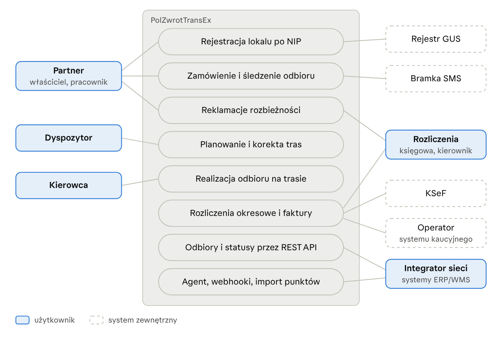

# PolZwrotTransEx – Specyfikacja Wymagań Oprogramowania (SRS)

## 1. Wstęp

### 1.1. Cel

Dokument opisuje wymagania dla systemu **PolZwrotTransEx w wersji 1.0 (MVP)**, platformy do obsługi logistyki opakowań kaucyjnych. Wersja dokumentu: 0.1 (robocza).

Dokument jest przeznaczony dla zespołu projektowego, Product Ownera. Stanowi podstawę backlogu w Jira, kryteriów akceptacji i testów.

### 1.2. Wizja, zakres i cele produktu

#### 1.2.1 Wizja

„Każde opakowanie kaucyjne nie czeka na zapleczu i wraca do obiegu z korzyścią dla lokalu i dla środowiska.”

#### 1.2.2 Zakres

System obejmuje pięć obszarów:

- **Portal samoobsługowy partnera**: rejestracja lokalu, zamawianie odbiorów, śledzenie statusu, podgląd rozliczeń.
- **Moduł optymalizacji tras i zarządzania flotą**: automatyczne planowanie tras, panel dyspozytora, aplikacja mobilna kierowcy.
- **Moduł rozliczeń i fakturowania**: faktury okresowe, wysyłka do KSeF, reklamacje rozbieżności.
- **Platforma integracyjna dla klientów korporacyjnych**: REST API, webhooki, agent on-premises, masowy import punktów.
- **Infrastruktura chmurowa i DevOps**: środowiska, CI/CD, kopie zapasowe, monitoring.

**Cele biznesowe i KPI.** Główny cel: w ciągu 6 miesięcy od uruchomienia MVP obsługa 500 lokali na terenie Krakowa i powiatu krakowskiego oraz współpraca z dużą siecią sklepów posiadającą co najmniej 50 sklepów jako podstawa ekspansji.

| Cel                  | KPI                                                                      | Sposób pomiaru                           |
| -------------------- | ------------------------------------------------------------------------ | ---------------------------------------- |
| Pozyskanie partnerów | Ponad 500 lokali objętych programem w 6 miesięcy                         | Liczba aktywnych punktów w systemie      |
| Obieg opakowań       | Ponad 300 000 zebranych opakowań w 6 miesięcy                            | Suma opakowań potwierdzonych w magazynie |
| Ekspansja            | Współpraca z siecią sklepów obejmująca co najmniej 50 placówek tej sieci | Liczba podpisanych umów z sieciami       |

**Cele użytkowników.**

| Rola       | Cel                                        | Kryterium                                              |
| ---------- | ------------------------------------------ | ------------------------------------------------------ |
| Partner    | Zamówić odbiór z telefonu bez dzwonienia   | Czas zgłoszenia poniżej 2 min                          |
| Dyspozytor | Nie układać tras ręcznie                   | Plan dla 150 zgłoszeń i 5 pojazdów w ≤ 60 s            |
| Kierowca   | Dostać gotową trasę i pracować bez zasięgu | 100% funkcji pobranej trasy dostępne offline           |
| Księgowa   | Nie przepisywać ilości i kwot ręcznie      | Faktura okresowa generowana automatycznie z przeliczeń |

**Poza zakresem MVP:**

- obsługa automatów zwrotnych (butelkomatów),
- rola operatora systemu kaucyjnego, czyli rozliczanie kaucji z producentami,
- obszar poza Krakowem i powiatem krakowskim,
- płatności online w portalu,
- natywna aplikacja mobilna dla partnera,
- zarządzanie magazynem poza przyjęciem wyniku przeliczenia,
- kadry, płace i serwis pojazdów.

### 1.3. Definicje, akronimy i skróty

| Pojęcie             | Znaczenie                                                                                                       |
| ------------------- | --------------------------------------------------------------------------------------------------------------- |
| System kaucyjny     | Ustawowy system zwrotu opakowań po napojach, działający w Polsce od 1.10.2025 r.                                |
| Kaucja              | Kwota doliczana do opakowania: 0,50 zł za butelkę PET i puszkę, 1 zł za butelkę szklaną wielokrotnego użytku    |
| Operator            | Operator systemu kaucyjnego (np. Kaucja.pl), system i interesariusz zewnętrzny                                  |
| Partner             | Firma oddająca opakowania: sklep, restauracja, hotel                                                            |
| Punkt (lokal)       | Adres partnera, z którego odbierane są opakowania. Jedna firma może mieć wiele punktów                          |
| Zgłoszenie odbioru  | Zamówienie odbioru opakowań z punktu, ze statusami: zgłoszony → zaplanowany → w drodze → odebrany → przeliczony |
| Przeliczenie        | Liczba opakowań potwierdzona w magazynie po odbiorze                                                            |
| Rozbieżność         | Różnica między deklaracją partnera a przeliczeniem powyżej progu tolerancji                                     |
| Reklamacja          | Zgłoszenie partnera kwestionujące przeliczenie                                                                  |
| Okres rozliczeniowy | Okres, za który wystawiana jest faktura                                                                         |
| Okno czasowe        | Przedział godzin, w którym punkt może przyjąć kierowcę                                                          |
| Duży sklep          | Sklep o powierzchni sprzedaży powyżej 200 m².                                                                   |
| Sieć sklepów        | Co najmniej 10 sklepów działających pod wspólną marką handlową                                                  |
| Duża sieć sklepów   | Sieć sklepów, która posiada co najmniej 50 placówek                                                             |
| KSeF                | Krajowy System e-Faktur                                                                                         |
| UPO                 | Urzędowe Poświadczenie Odbioru faktury w KSeF                                                                   |
| GUS / REGON         | Rejestr, z którego pobierane są dane firmy po NIP                                                               |
| OSRM / OSM          | Open Source Routing Machine / OpenStreetMap, silnik routingu i dane mapowe                                      |
| Agent on-premises   | Komponent instalowany w sieci klienta korporacyjnego, łączący jego systemy z platformą                          |
| Webhook             | Powiadomienie HTTP wysyłane do systemu klienta po zdarzeniu                                                     |
| RPO                 | Dopuszczalna utrata danych                                                                                      |
| RTO                 | czas odtworzenia po awarii                                                                                      |
| RWD                 | Responsive Web Design                                                                                           |
| PoC                 | Proof of Concept                                                                                                |
| MVP                 | Minimum Viable Product                                                                                          |
| SCT                 | Strefa Czystego Transportu w Krakowie                                                                           |

### 1.4. Przegląd dokumentu

Rozdział 2 opisuje funkcje, użytkowników, ograniczenia i założenia. Rozdział 3 definiuje interfejsy użytkownika i integracje. Rozdział 4 zawiera wymagania funkcjonalne z kryteriami Given–When–Then i priorytetyzacją. Rozdział 5 określa atrybuty jakościowe. Rozdział 6 przedstawia analizę porównawczą. Dodatki zawierają przypadki użycia, persony i kwestie otwarte.

## 2. Opis ogólny

### 2.1. Główne funkcje produktu

System składa się z pięciu modułów. Szczegóły funkcji opisuje rozdział 4.

| Moduł                   | Główne funkcje                                                                                                                         |
| ----------------------- | -------------------------------------------------------------------------------------------------------------------------------------- |
| Portal partnera         | Rejestracja lokalu po NIP, logowanie, zamawianie odbiorów, śledzenie statusu, powiadomienia SMS i e-mail, wiele punktów i użytkowników |
| Trasy i flota           | Automatyczne planowanie tras, ręczna korekta na mapie, aplikacja kierowcy działająca offline, podgląd floty                            |
| Rozliczenia             | Faktura za okres rozliczeniowy, wysyłka do KSeF, reklamacje rozbieżności, cenniki, uzgadnianie ilości z operatorem                     |
| Integracje korporacyjne | REST API do zamawiania odbiorów i raportowania ilości, webhooki, agent on-premises, masowy import punktów                              |
| Infrastruktura          | CI/CD, środowiska jako konfiguracja, kopie zapasowe i odtwarzanie, logi, metryki i alerty                                              |

### 2.2. Klasy użytkowników

Persony dla głównych ról znajdują się w Dodatku B.

| Rola                        | Opis                                                                 | Moduł                   | Kluczowe uprawnienia                                                 |
| --------------------------- | -------------------------------------------------------------------- | ----------------------- | -------------------------------------------------------------------- |
| Partner – właściciel        | Właściciel sklepu, restauracji lub hotelu. Rejestruje firmę i punkty | Portal partnera         | Wszystko w ramach firmy, w tym rozliczenia i zapraszanie pracowników |
| Partner – pracownik         | Pracownik lokalu zgłaszający odbiory                                 | Portal partnera         | Zgłoszenia tylko dla przypisanych punktów, bez kwot i faktur         |
| Kierowca                    | Realizuje trasę i potwierdza odbiory                                 | Trasy i flota           | Własna trasa, potwierdzanie odbioru, zgłaszanie problemów            |
| Dyspozytor                  | Planuje i koryguje trasy, nadzoruje flotę                            | Trasy i flota           | Zgłoszenia, trasy, pojazdy, kierowcy                                 |
| Księgowa                    | Zatwierdza faktury, rozstrzyga reklamacje                            | Rozliczenia             | Przeliczenia, faktury, reklamacje, cenniki                           |
| Integrator sieci IT         | Architekt IT w sieci sklepów                                         | Integracje korporacyjne | Klucze API, webhooki, import punktów sieci                           |
| Zespół operacyjny           | Utrzymuje środowiska, kopie i wdrożenia                              | Infrastruktura          | Rola operacyjna: kopie zapasowe, odtwarzanie, wdrożenia              |
| Operator systemu kaucyjnego | Kaucja.pl, podmiot zewnętrzny                                        | Integracje korporacyjne | Odbiór raportów i uzgadnianie ilości                                 |

### 2.3. Ograniczenia projektowe i implementacyjne

#### 2.3.1 Technologiczne

- Baza danych PostgreSQL jako usługa zarządzana w regionie UE.
- Backend uruchamiany w kontenerach, wdrażany wyłącznie przez pipeline CI/CD.
- Routing oparty na OSRM i danych OpenStreetMap dla Małopolski. Budżet MVP nie przewiduje komercyjnych API mapowych.
- Portal partnera jako aplikacja webowa.
- Aplikacja kierowcy musi działać bez dostępu do internetu.
- Faktury wyłącznie w formacie ustrukturyzowanym, wysyłane do KSeF przez API.
- Publiczne REST API jest wersjonowane.

#### 2.3.2 Organizacyjne

- Zespół 5 osób, każdy jest odpowiedzialny za swój moduł.
- Scrum, sprinty dwutygodniowe, backlog w Jira.
- MVP w maksymalnie 3 miesiące.
- Sprint 1 jest przeznaczony na PoC planowania tras.
- Obszar działania MVP: Kraków i powiat krakowski.

#### 2.3.3 Prawne i środowiskowe

- Przepisy o systemie kaucyjnym, w tym obowiązki raportowe.
- RODO: dane osobowe partnerów i kierowców przechowywane wyłącznie w UE.
- Obowiązek wystawiania faktur w KSeF. Kaucja wykazywana poza podstawą VAT.
- Ograniczenia ruchu w Krakowie: Strefa Czystego Transportu, limity tonażu, zakazy wjazdu do Starego Miasta.
- Przepisy o czasie pracy kierowców.

### 2.4. Założenia projektowe

| Założenie                                                               | Ryzyko, jeśli fałszywe                          | Sposób walidacji                                             |
| ----------------------------------------------------------------------- | ----------------------------------------------- | ------------------------------------------------------------ |
| Partnerzy zarejestrują się sami, bez wizyty przedstawiciela             | Nie osiągniemy 500 lokali                       | Test rejestracji z 5 właścicielami lokali.                   |
| Otwarty solver z OSRM ułoży plan dla 150 zgłoszeń i 5 pojazdów w ≤ 60 s | Planowanie pozostaje ręczne albo wzrost kosztów | PoC w Sprincie 1                                             |
| Deklarowana liczba opakowań wystarcza do planowania pojemności          | Przepełnione pojazdy, puste kursy               | Porównanie deklaracji z przeliczeniami w pilotażu            |
| Wynik przeliczenia z magazynu jest dostępny w formie cyfrowej           | Brak danych do faktur i reklamacji              | Ustalenie źródła danych (Dodatek C)                          |
| Lokal oddaje średnio ok. 200 opakowań miesięcznie                       | Nie osiągniemy 300 000 opakowań                 | Wywiady z 10 lokalami, dane z pilotażu                       |
| Kierowcy mają smartfony z Androidem i GPS                               | Aplikacja mobilna bezużyteczna                  | Ankieta wśród kierowców. Wariant zapasowy: telefony służbowe |
| API GUS i KSeF są dostępne i stabilne                                   | Zablokowana rejestracja lub fakturowanie        | Ścieżka ręczna przy rejestracji, ponawianie wysyłki do KSeF  |

## 3. Wymagania dotyczące interfejsów zewnętrznych

### 3.1. Interfejsy użytkownika (UI)

System ma trzy interfejsy, każdy dopasowany do warunków pracy użytkownika:

- **Portal partnera:** responsywna aplikacja webowa. Duże przyciski, formularze wielokrokowe, komunikaty błędów przy polach, śledzenie statusu odbioru.
- **Panel dyspozytora i rozliczeń:** aplikacja webowa na komputer. Widok mapy z trasami, listy i tabele z filtrowaniem.
- **Aplikacja kierowcy:** aplikacja mobilna z listą przystanków, obsługiwana jedną ręką, działająca offline.

Język interfejsu: polski. Statusy mają stałe nazwy i kolory we wszystkich interfejsach.

#### 3.1.1 Aplikacja kierowcy

#### 3.1.2 Widok dyspozytora

#### 3.1.3 Widok partnera

### 3.2. Interfejsy programowe (API)

| System                      | Kierunek      | Cel                                                              |
| --------------------------- | ------------- | ---------------------------------------------------------------- |
| GUS (rejestr REGON)         | Wychodzący    | Pobranie danych firmy po NIP przy rejestracji                    |
| Bramka SMS                  | Wychodzący    | Kod aktywacyjny i powiadomienia o statusie                       |
| Usługa e-mail               | Wychodzący    | Powiadomienia o statusie, zaproszenia pracowników                |
| OSRM                        | Wewnętrzny    | Macierz czasów i odległości między punktami                      |
| Geokoder oparty na OSM      | Wychodzący    | Zamiana adresu punktu na współrzędne, z pamięcią podręczną       |
| KSeF                        | Dwukierunkowy | Wysyłka, odbiór faktur i korekt, odbiór numeru KSeF i UPO        |
| Operator systemu kaucyjnego | Dwukierunkowy | Uzgadnianie ilości przekazanych opakowań, raporty                |
| System księgowy             | Wychodzący    | Eksport dokumentów rozliczeniowych                               |
| REST API                    | Przychodzący  | Zamawianie odbiorów, statusy i ilości dla systemów sieci         |
| Webhooki                    | Wychodzący    | Powiadamianie systemów sieci o zdarzeniach                       |
| Agent on-premises           | Dwukierunkowy | Bezpieczne połączenie systemów sieci z platformą, import punktów |
| Nawigacja w telefonie       | Wychodzący    | Skrót z przystanku do nawigacji GPS                              |
| Magazyn                     | Przychodzący  | Raportowanie odebranych opakowań                                 |

Wymagania wspólne dla interfejsów przychodzących: uwierzytelnianie kluczem API, komunikacja szyfrowana (TLS), limit żądań na klucz, odpowiedzi w formacie JSON.

## 4. Wymagania funkcjonalne

Rozdział opisuje osiem głównych funkcjonalności.

### WF-REJ: Rejestracja lokalu po NIP

- **Opis:** Partner zakłada konto firmy i rejestruje pierwszy punkt odbioru samodzielnie, z telefonu. Dane firmy są pobierane z rejestru GUS na podstawie NIP.
- **Historyjka użytkownika:** Jako właściciel restauracji chcę zarejestrować lokal z telefonu, podając NIP, aby dołączyć do programu bez wizyty przedstawiciela.
- **Cel biznesowy:** Pozyskanie ponad 500 lokali w 6 miesięcy bez kosztu przedstawicieli handlowych.
- **Warunki wstępne:** Użytkownik nie ma konta. Ma dostęp do telefonu z przeglądarką i numer telefonu do odbioru SMS.
- **Warunki końcowe:** W systemie istnieje firma, punkt ze statusem „aktywny” i użytkownik z rolą „właściciel”. Akceptacja umowy jest zapisana.

**WF-REJ-01: Rejestracja z poprawnym NIP (scenariusz główny)**

- **Given:** Jestem na formularzu rejestracji i nie mam konta.
- **When:** Wpisuję poprawny NIP, którego nie ma jeszcze w systemie.
- **Then:** Formularz uzupełnia się nazwą firmy, numerem REGON i adresem siedziby z GUS.
- **And:** Mogę edytować pobrane pola.
- **When:** Podaję adres punktu, godziny dostępności i co najmniej jeden typ opakowań, akceptuję umowę i wpisuję kod z SMS.
- **Then:** Konto jest aktywne, mam rolę „właściciel”, a punkt ma status „aktywny”.
- **And:** System zapisuje wersję umowy, datę, godzinę i ID użytkownika.

**WF-REJ-02: Rejestr GUS nie odpowiada (scenariusz alternatywny)**

- **Given:** Wpisałem poprawny NIP.
- **And:** Rejestr GUS nie odpowiada w ciągu 5 s.
- **When:** Formularz kończy oczekiwanie.
- **Then:** Pola danych firmy są puste i mogę wypełnić je ręcznie.
- **And:** Po zakończeniu rejestracji konto ma flagę „do weryfikacji”.

**WF-REJ-03: NIP już zarejestrowany (scenariusz wyjątkowy)**

- **Given:** W systemie istnieje firma o danym NIP.
- **When:** Wpisuję ten NIP w formularzu rejestracji.
- **Then:** System nie tworzy nowej firmy.
- **And:** Widzę komunikat z opcją wysłania prośby o dostęp do właściciela konta.

**WF-REJ-04: Błędny NIP lub wygasły kod SMS (scenariusz wyjątkowy)**

- **Given:** Wpisałem NIP z błędną sumą kontrolną.
- **When:** Próbuję przejść dalej.
- **Then:** Formularz nie zostaje wysłany, a przy polu widzę komunikat o błędzie.
- **Given:** Dostałem kod SMS ponad 10 minut temu.
- **When:** Wpisuję ten kod.
- **Then:** Konto nie zostaje aktywowane i mogę poprosić o nowy kod.

### WF-ODB: Zamówienie odbioru i śledzenie statusu

- **Opis:** Partner zgłasza odbiór zebranych opakowań z wybranego punktu i śledzi postęp realizacji. O kluczowych zmianach statusu dostaje SMS i e-mail.
- **Historyjka użytkownika:** Jako właściciel restauracji chcę zamówić odbiór opakowań z telefonu i dostać SMS z terminem, aby opakowania nie zajmowały miejsca na zapleczu, a pracownicy nie musieli ich nigdzie wozić.
- **Cel biznesowy:** Realizacja wizji „≤ 3 dni” i obsługa partnerów bez kontaktu telefonicznego.
- **Warunki wstępne:** Użytkownik jest zalogowany i ma dostęp do co najmniej jednego aktywnego punktu.
- **Warunki końcowe:** Zgłoszenie jest zapisane ze statusem „zgłoszony” i widoczne dla dyspozytora. Czas utworzenia jest zapisany.

**WF-ODB-01: Zamówienie odbioru (scenariusz główny)**

- **Given:** Jestem zalogowanym partnerem z aktywnym punktem bez otwartego zgłoszenia.
- **When:** Wybieram punkt, podaję liczbę opakowań i co najmniej jeden typ opakowań, a następnie wysyłam formularz.
- **Then:** Zgłoszenie otrzymuje status „zgłoszony”.
- **And:** Zgłoszenie jest widoczne w panelu dyspozytora.
- **And:** Dostaję e-mail z potwierdzeniem.

**WF-ODB-02: Powiadomienie o terminie (scenariusz główny)**

- **Given:** Mam zgłoszenie ze statusem „zgłoszony”.
- **When:** Dyspozytor wysyła plan tras i status zmienia się na „zaplanowany”.
- **Then:** Dostaję SMS i e-mail z datą i przedziałem godzin odbioru.
- **And:** Zmiana jest widoczna w historii zgłoszenia z datą i godziną.
- **When:** Status zmienia się na „w drodze”.
- **Then:** Dostaję SMS i e-mail.

**WF-ODB-03: Punkt ma otwarte zgłoszenie (scenariusz alternatywny)**

- **Given:** Punkt ma zgłoszenie ze statusem „zgłoszony” lub „zaplanowany”.
- **When:** Próbuję zamówić kolejny odbiór dla tego punktu.
- **Then:** Widzę ostrzeżenie o otwartym zgłoszeniu.
- **And:** Mogę zmienić liczbę opakowań w istniejącym zgłoszeniu zamiast tworzyć nowe.

**WF-ODB-04: Anulowanie po wyjeździe kierowcy (scenariusz wyjątkowy)**

- **Given:** Moje zgłoszenie ma status „w drodze”, „odebrany” lub „przeliczony”.
- **When:** Otwieram szczegóły zgłoszenia.
- **Then:** Przycisk „Anuluj” nie jest dostępny.

**WF-ODB-05: Pracownik bez dostępu do punktu (scenariusz wyjątkowy)**

- **Given:** Jestem zalogowany jako pracownik z dostępem tylko do punktu A.
- **When:** Otwieram formularz zgłoszenia.
- **Then:** Na liście punktów widzę wyłącznie punkt A.
- **And:** Nie widzę zgłoszeń innych punktów firmy.

### WF-TRA: Automatyczne planowanie tras i ręczna korekta

- **Opis:** System grupuje zgłoszenia odbiorów w trasy, przydziela je do pojazdów i kierowców oraz pozwala dyspozytorowi poprawić plan na mapie.
- **Historyjka użytkownika:** Jako dyspozytor chcę, aby system automatycznie grupował zgłoszenia w zoptymalizowane trasy i pozwalał mi na ich ręczną korektę na mapie, aby nie układać harmonogramów ręcznie i mieć pewność, że żaden worek nie czeka dłużej niż 3 dni.
- **Cel biznesowy:** Realizacja wizji „≤ 3 dni” przy rosnącej liczbie lokali, niższe koszty paliwa .
- **Warunki wstępne:** Dyspozytor jest zalogowany. Istnieją zgłoszenia ze statusem „zgłoszony” oraz pojazdy z pojemnością i grafikami kierowców.
- **Warunki końcowe:** Zatwierdzony plan jest wysłany do kierowców, a zgłoszenia mają status „zaplanowany” z datą i przedziałem godzin.

**WF-TRA-01: Wygenerowanie planu dnia (scenariusz główny)**

- **Given:** W systemie jest 150 zgłoszeń ze statusem „zgłoszony” i 5 dostępnych pojazdów.
- **When:** Klikam „Generuj plan” dla wybranego dnia.
- **Then:** W czasie ≤ 60 s widzę na mapie trasy przypisane do pojazdów i kierowców.
- **And:** Ładunek żadnej trasy nie przekracza pojemności pojazdu.
- **And:** Każdy przystanek jest zaplanowany w oknie czasowym punktu.
- **And:** Zgłoszenia, którym kończy się limit 3 dni, są zaplanowane w pierwszej kolejności.

**WF-TRA-02: Ręczna korekta trasy (scenariusz alternatywny)**

- **Given:** Mam wygenerowany, niewysłany plan.
- **When:** Przenoszę przystanek z trasy A do trasy B.
- **Then:** System przelicza czas przejazdu i ładunek obu tras.
- **And:** Jeśli zmiana narusza pojemność lub okno czasowe, widzę ostrzeżenie ze wskazaniem przystanku.

**WF-TRA-03: Wysłanie planu do kierowców (scenariusz główny)**

- **Given:** Mam plan bez naruszeń pojemności i okien czasowych.
- **When:** Klikam „Wyślij plan”.
- **Then:** Każdy kierowca widzi swoją trasę w aplikacji mobilnej.
- **And:** Zgłoszenia z planu otrzymują status „zaplanowany”.

**WF-TRA-04: Za mało pojazdów (scenariusz wyjątkowy)**

- **Given:** Łączna liczba opakowań w zgłoszeniach przekracza pojemność dostępnych pojazdów.
- **When:** Generuję plan.
- **Then:** Widzę listę zgłoszeń niezaplanowanych wraz z przyczyną.
- **And:** Zgłoszenia, które przekroczą limit 3 dni, są wyróżnione.

### WF-MOB: Lista przystanków i rejestracja odbioru w aplikacji kierowcy

- **Opis:** Kierowca widzi uporządkowaną listę przystanków, uruchamia nawigację i potwierdza odbiór. Aplikacja działa również bez dostępu do internetu.
- **Historyjka użytkownika:** Jako kierowca chcę mieć w aplikacji mobilnej uporządkowaną listę przystanków, nawigację i prosty formularz potwierdzania odbioru, które działają również bez internetu, aby realizować trasę bez dzwonienia do dyspozytora i bez ryzyka utraty danych.
- **Cel biznesowy:** Wiarygodne dane o odbiorach jako podstawa rozliczeń, mniej telefonów do dyspozytora.
- **Warunki wstępne:** Kierowca jest zalogowany i pobrał trasę na dany dzień.
- **Warunki końcowe:** Odbiór jest zapisany z czasem, kodami opakowań zbiorczych i dowodem (zdjęcie lub podpis). Zgłoszenie ma status „odebrany”.

**WF-MOB-01: Potwierdzenie odbioru (scenariusz główny)**

- **Given:** Mam pobraną trasę i jestem na przystanku.
- **When:** Skanuję kody opakowań zbiorczych i dodaję zdjęcie lub podpis osoby wydającej.
- **Then:** Przystanek jest oznaczony jako zrealizowany.
- **And:** Zgłoszenie otrzymuje status „odebrany” z czasem zarejestrowanym na urządzeniu.

**WF-MOB-02: Praca bez zasięgu (scenariusz alternatywny)**

- **Given:** Mam pobraną trasę, a telefon nie ma dostępu do internetu.
- **When:** Potwierdzam odbiór na przystanku.
- **Then:** Odbiór zapisuje się na urządzeniu, a lista przystanków i skrót do nawigacji działają dalej.
- **When:** Telefon odzyskuje zasięg.
- **Then:** Zapisane odbiory synchronizują się automatycznie, bez mojego udziału.
- **And:** Żaden zarejestrowany odbiór nie zostaje utracony ani zdublowany.

**WF-MOB-03: Lokal zamknięty (scenariusz wyjątkowy)**

- **Given:** Jestem na przystanku i nie mogę odebrać opakowań.
- **When:** Zgłaszam problem, wybierając przyczynę (np. „lokal zamknięty”).
- **Then:** Przystanek jest oznaczony jako nieudany, a dyspozytor widzi zgłoszenie problemu.
- **And:** Zgłoszenie odbioru wraca do planowania z zachowaniem pierwotnego czasu utworzenia.

### WF-FAK: Faktura za okres rozliczeniowy i wysyłka do KSeF

- **Opis:** Po zamknięciu okresu system zbiera zatwierdzone przeliczenia partnera, nalicza kwoty według cennika i tworzy fakturę, która trafia do KSeF.
- **Historyjka użytkownika:** Jako księgowa PolZwrotTransEx chcę, aby system po zamknięciu okresu rozliczeniowego sam wygenerował fakturę dla partnera na podstawie przeliczeń z magazynu i wysłał ją do KSeF, tak żebym nie musiała ręcznie przepisywać ilości i kwot.
- **Cel biznesowy:** Rozliczenie 500 lokali bez zwiększania zespołu księgowego i zgodność z obowiązkiem KSeF.
- **Warunki wstępne:** Okres rozliczeniowy jest zamknięty. Partner ma co najmniej jedno zatwierdzone przeliczenie. Cennik dla okresu jest zdefiniowany.
- **Warunki końcowe:** Faktura ma numer KSeF i UPO. Partner widzi ją w portalu jako PDF i XML wraz z zestawieniem przeliczeń.

**WF-FAK-01: Wygenerowanie i wysyłka faktury (scenariusz główny)**

- **Given:** Okres rozliczeniowy partnera jest zamknięty i zawiera zatwierdzone przeliczenia bez otwartych reklamacji.
- **When:** System zamyka okres.
- **Then:** Powstaje szkic faktury z pozycjami rozdzielonymi na PET, puszki i szkło.
- **And:** Ilości są zgodne z przeliczeniami, a kwoty z cennikiem obowiązującym w dniu przeliczenia.
- **And:** Kaucja jest wykazana osobno, poza podstawą VAT.
- **When:** Zatwierdzam szkic.
- **Then:** Faktura trafia do KSeF, a system zapisuje numer KSeF i UPO.

**WF-FAK-02: Przeliczenie z otwartą reklamacją (scenariusz alternatywny)**

- **Given:** Jedno z przeliczeń partnera w okresie ma otwartą reklamację.
- **When:** System tworzy szkic faktury.
- **Then:** To przeliczenie nie trafia na fakturę.
- **And:** W szkicu widzę informację o pominiętym przeliczeniu.

**WF-FAK-03: Błąd wysyłki do KSeF (scenariusz wyjątkowy)**

- **Given:** Zatwierdziłam fakturę, a KSeF zwraca błąd lub nie odpowiada.
- **When:** System wysyła fakturę.
- **Then:** System ponawia wysyłkę do 3 razy.
- **And:** Po trzeciej nieudanej próbie dostaję powiadomienie, a faktura ma status „oczekuje na wysyłkę”.

**WF-FAK-04: Druga faktura za ten sam okres (scenariusz wyjątkowy)**

- **Given:** Za dany okres istnieje już faktura pierwotna partnera.
- **When:** Próbuję wystawić kolejną fakturę pierwotną za ten okres.
- **Then:** System odmawia i wskazuje, że zmiana jest możliwa tylko przez korektę.

### WF-REK: Zgłaszanie i rozstrzyganie rozbieżności

- **Opis:** System porównuje deklarację partnera z przeliczeniem w magazynie. Partner może zgłosić reklamację, którą rozstrzyga pracownik rozliczeń.
- **Historyjka użytkownika:** Jako partner chcę zgłosić reklamację, gdy liczba opakowań przeliczona w magazynie różni się od mojej deklaracji, tak żeby rozbieżność została wyjaśniona przed wystawieniem faktury.
- **Cel biznesowy:** Zaufanie partnerów do rozliczeń i ich utrzymanie w programie.
- **Warunki wstępne:** Odbiór ma status „przeliczony”. Partner jest zalogowany jako właściciel.
- **Warunki końcowe:** Reklamacja ma status „Zamknięta”, a ilość do rozliczenia odpowiada rozstrzygnięciu. Każda zmiana statusu jest w historii.

**WF-REK-01: Zgłoszenie reklamacji (scenariusz główny)**

- **Given:** Przeliczenie różni się od mojej deklaracji o więcej niż próg tolerancji (domyślnie 2%).
- **Then:** Przeliczenie jest oznaczone jako „Rozbieżność”.
- **When:** W ciągu 14 dni od przeliczenia zgłaszam reklamację z ilością, uzasadnieniem i opcjonalnym załącznikiem.
- **Then:** Reklamacja otrzymuje status „Nowa”.
- **And:** Przeliczenie nie trafia na fakturę do czasu zamknięcia reklamacji.

**WF-REK-02: Uznanie reklamacji (scenariusz główny)**

- **Given:** Jestem pracownikiem rozliczeń i reklamacja ma status „W analizie”.
- **When:** Uznaję reklamację w całości lub w części.
- **Then:** Ilość do rozliczenia zostaje zaktualizowana.
- **And:** Jeśli faktura za ten okres była już wystawiona, system tworzy szkic korekty.

**WF-REK-03: Odrzucenie reklamacji (scenariusz alternatywny)**

- **Given:** Jestem pracownikiem rozliczeń i reklamacja ma status „W analizie”.
- **When:** Próbuję odrzucić reklamację bez uzasadnienia.
- **Then:** System nie zapisuje zmiany i wymaga uzasadnienia dla partnera.

**WF-REK-04: Reklamacja po terminie (scenariusz wyjątkowy)**

- **Given:** Od przeliczenia minęło więcej niż 14 dni.
- **When:** Otwieram szczegóły odbioru.
- **Then:** Opcja zgłoszenia reklamacji nie jest dostępna.

**WF-REK-05: Reklamacja nierozpatrzona w terminie (scenariusz wyjątkowy)**

- **Given:** Reklamacja nie została rozstrzygnięta w ciągu 7 dni roboczych.
- **When:** Mija termin.
- **Then:** Reklamacja trafia do kierownika rozliczeń.

### WF-API: Zamawianie odbiorów i raportowanie ilości przez REST API

- **Opis:** Systemy sieci sklepów (ERP, WMS) zlecają odbiory i pobierają statusy oraz zweryfikowane ilości przez wersjonowane REST API.
- **Historyjka użytkownika:** Jako integrator systemów ERP/WMS w dużej sieci sklepów chcę automatycznie zlecać odbiory opakowań zwrotnych oraz pobierać statusy i zweryfikowane ilości przez wersjonowane REST API, aby wyeliminować ręczną obsługę portalu w setkach placówek.
- **Cel biznesowy:** Pozyskanie sieci sklepów i przygotowanie ekspansji.
- **Warunki wstępne:** Sieć ma aktywny klucz API. Punkt, którego dotyczy żądanie, jest zarejestrowany, aktywny i należy do tej sieci.
- **Warunki końcowe:** Zgłoszenie utworzone przez API ma status „zgłoszony” i trafia do tej samej kolejki planowania co zgłoszenia z portalu.

**WF-API-01: Utworzenie zgłoszenia przez API (scenariusz główny)**

- **Given:** System sieci ma poprawny klucz API, a punkt jest aktywny i nie ma otwartego zgłoszenia.
- **When:** System sieci wysyła żądanie utworzenia odbioru z identyfikatorem punktu, liczbą opakowań i ich typami.
- **Then:** API zwraca potwierdzenie z identyfikatorem zgłoszenia.
- **And:** Zgłoszenie ma status „zgłoszony” i jest widoczne w panelu dyspozytora.

**WF-API-02: Pobranie statusu i ilości (scenariusz główny)**

- **Given:** Sieć ma zgłoszenie ze statusem „przeliczony”.
- **When:** System sieci pyta o zgłoszenie po identyfikatorze.
- **Then:** API zwraca status, historię zmian i liczbę opakowań potwierdzoną w magazynie w podziale na typy.

**WF-API-03: Powtórzone żądanie (scenariusz alternatywny)**

- **Given:** System sieci wysłał żądanie utworzenia odbioru z kluczem idempotencji.
- **When:** Wysyła to samo żądanie ponownie z tym samym kluczem.
- **Then:** API zwraca pierwotne zgłoszenie i nie tworzy duplikatu.

**WF-API-04: Brak uprawnień lub przekroczony limit (scenariusz wyjątkowy)**

- **Given:** Żądanie ma nieprawidłowy klucz API albo dotyczy punktu spoza sieci.
- **When:** System sieci wysyła żądanie.
- **Then:** API odmawia z kodem błędu i opisem przyczyny, a zgłoszenie nie powstaje.
- **Given:** Klucz przekroczył limit żądań.
- **When:** System sieci wysyła kolejne żądanie.
- **Then:** API odmawia i podaje czas, po którym można ponowić żądanie.

### WF-AGT: Agent on-premises, webhooki i masowy import punktów

- **Opis:** Sieć instaluje w swojej infrastrukturze agenta integracyjnego, odbiera zdarzenia przez webhooki i importuje wiele punktów naraz.
- **Historyjka użytkownika:** Jako architekt IT w dużej sieci sklepów chcę wdrożyć w infrastrukturze sieci bezpieczny komponent on-premises obsługujący zdarzenia przez webhooki oraz masowy import punktów sprzedaży, aby dane wrażliwe pozostawały pod kontrolą sieci, a uruchomienie setek placówek było zautomatyzowane.
- **Cel biznesowy:** Usunięcie bariery wejścia dla sieci z wymaganiami bezpieczeństwa.
- **Warunki wstępne:** Sieć ma podpisaną umowę i wykupiony klucz dostępu.
- **Warunki końcowe:** Agent ma status „aktywny”. Punkty sieci są zarejestrowane. Zdarzenia docierają do systemu sieci.

**WF-AGT-01: Instalacja i aktywacja agenta (scenariusz główny)**

- **Given:** Administrator sieci pobrał oficjalny obraz agenta i sprawdził jego sumę kontrolną.
- **When:** Uruchamia agenta w sieci wewnętrznej i podaje ważny klucz dostępu.
- **Then:** Agent nawiązuje szyfrowane połączenie wychodzące z platformą.
- **And:** W panelu integratora agent ma status „aktywny”.

**WF-AGT-02: Dostarczenie zdarzenia przez webhook (scenariusz główny)**

- **Given:** Sieć zarejestrowała adres webhooka dla zdarzenia „zmiana statusu odbioru”.
- **When:** Zgłoszenie punktu sieci zmienia status.
- **Then:** Platforma wysyła podpisane powiadomienie na zarejestrowany adres.

**WF-AGT-03: Masowy import punktów (scenariusz główny)**

- **Given:** Integrator ma plik z listą punktów sieci.
- **When:** Importuje plik.
- **Then:** Poprawne wiersze tworzą punkty przypisane do sieci.
- **And:** Wiersze z błędami trafiają do raportu z numerem wiersza i przyczyną, bez przerywania importu.

**WF-AGT-04: Odbiorca webhooka nie odpowiada (scenariusz alternatywny)**

- **Given:** Adres webhooka sieci nie odpowiada.
- **When:** Platforma wysyła powiadomienie.
- **Then:** Platforma ponawia wysyłkę z rosnącym odstępem.
- **And:** Po wyczerpaniu prób zdarzenie jest oznaczone jako niedostarczone i widoczne w panelu integratora.

**WF-AGT-05: Nieprawidłowy klucz dostępu (scenariusz wyjątkowy)**

- **Given:** Klucz dostępu jest nieprawidłowy, wygasł albo jest aktywny na innej instancji agenta.
- **When:** Administrator próbuje aktywować agenta.
- **Then:** Aktywacja zostaje odrzucona z komunikatem o przyczynie.

### 4.1. Priorytetyzacja wymagań

| Wymaganie                 | Korzyść | Kara | Koszt | Ryzyko | Priorytet |
| ------------------------- | ------- | ---- | ----- | ------ | --------- |
| WF-ODB Zamówienie odbioru | 21      | 21   | 8     | 3      | 3,82      |
| WF-REJ Rejestracja lokalu | 21      | 13   | 8     | 5      | 2,62      |
| WF-REK Reklamacje         | 8       | 8    | 8     | 3      | 1,45      |
| WF-FAK Faktura i KSeF     | 8       | 21   | 13    | 8      | 1,38      |
| WF-TRA Planowanie tras    | 21      | 13   | 13    | 13     | 1,31      |
| WF-MOB Aplikacja kierowcy | 13      | 13   | 13    | 8      | 1,24      |
| WF-API REST API           | 13      | 5    | 13    | 5      | 1,00      |
| WF-AGT Agent on-premises  | 8       | 3    | 21    | 13     | 0,32      |

## 5. Atrybuty jakościowe

### Jakość wykonania

**Użyteczność**

- **WNF-UZ-01:** Zalogowany partner zamawia odbiór w nie więcej niż 4 krokach. Mediana czasu w teście z 5 użytkownikami wynosi ≤ 2 minuty.

**Dostępność**

- **WNF-DOST-01:** Dostępność portalu partnera i REST API wynosi co najmniej 99,5% w skali miesiąca, z wyłączeniem planowanych okien serwisowych.
- **WNF-DOST-02:** Po awarii bazy danych utrata danych nie przekracza 1 godziny (RPO ≤ 1 h), a odtworzenie trwa najwyżej 4 godziny (RTO ≤ 4 h).
- **WNF-DOST-03:** Aplikacja kierowcy udostępnia 100% funkcji pobranej trasy bez dostępu do internetu. Po odzyskaniu zasięgu synchronizuje dane w ≤ 60 s bez utraty punktów odbioru.
- **WNF-DOST-04:** Alert o niedostępności backendu trafia do zespołu operacyjnego w ≤ 5 minut od awarii.

**Bezpieczeństwo**

- **WNF-BEZ-01:** Hasła użytkowników są hashowane algorytmem kryptograficznym. Po 5 nieudanych próbach logowania konto jest blokowane na 15 minut.
- **WNF-BEZ-02:** Dane i kopie zapasowe są przechowywane wyłącznie w regionach UE. Kopie są szyfrowane, a dodatkowa kopia trafia do drugiego regionu UE.
- **WNF-BEZ-03:** Dostęp do kopii zapasowych i operacji odtwarzania mają wyłącznie konta z rolą operacyjną. Każde odtworzenie jest zapisane w logach audytowych.
- **WNF-BEZ-04:** Pipeline blokuje merge, gdy skan zależności lub obrazu kontenera wykryje krytyczną podatność albo gdy w repozytorium zostanie wykryty sekret.
- **WNF-BEZ-05:** REST API i formularz zgłoszeń mają limit żądań: 60 żądań na minutę na klucz API i 1 otwarte zgłoszenie na punkt.
- **WNF-BEZ-06:** Sesja w portalu i panelach wygasa po 30 minutach bezczynności.

**Wydajność**

- **WNF-WYD-01:** Plan tras dla 150 zgłoszeń i 5 pojazdów powstaje w ≤ 60 s, bez naruszeń tonażu i okien czasowych.
- **WNF-WYD-02:** Czas odpowiedzi portalu partnera nie przekracza 2 s dla 95% żądań przy 200 jednoczesnych użytkownikach.
- **WNF-WYD-03:** Powiadomienie SMS trafia do bramki w ≤ 60 s od zmiany statusu.

**Skalowalność**

- **WNF-SKAL-01:** Planowanie obsługuje 500 punktów w jednym przebiegu w ≤ 15 minut.
- **WNF-SKAL-02:** Architektura pozwala obsłużyć 5 000 punktów i 50 pojazdów przez dodanie instancji backendu i podział planowania na strefy, bez zmian w kodzie modułów.

### Jakość projektu

**Modyfikowalność**

- **WNF-MOD-01:** Dodanie nowego typu opakowania oraz zmiana progu rozbieżności i cennika wymagają wyłącznie zmiany konfiguracji.
- **WNF-MOD-02:** Wymiana silnika routingu (OSRM na komercyjne API) wymaga zmiany jednego adaptera, bez modyfikacji modułu planowania.
- **WNF-MOD-03:** REST API jest wersjonowane. Poprzednia wersja jest utrzymywana co najmniej 6 miesięcy od wydania nowej.

**Testowalność**

- **WNF-TEST-01:** Pipeline dla pull requesta trwa nie dłużej niż 10 minut i obejmuje lint, testy jednostkowe oraz skany bezpieczeństwa.
- **WNF-TEST-02:** Procedura odtwarzania bazy z kopii jest testowana co najmniej raz na kwartał.

**Przenośność**

- **WNF-PRZEN-01:** Aplikacja uruchamia się na maszynie deweloperskiej jednym poleceniem `docker compose up`.
- **WNF-PRZEN-02:** Środowiska staging i produkcyjne są odtwarzalne z konfiguracji w repozytorium.

### 5.1. Priorytetyzacja atrybutów jakościowych

Kolejność od najważniejszego jest propozycją do dyskusji.

| Miejsce | Atrybut                    | Uzasadnienie                                                                                        |
| ------- | -------------------------- | --------------------------------------------------------------------------------------------------- |
| 1       | Użyteczność                | Cel 500 lokali zależy od tego, czy partner zarejestruje się i zamówi odbiór sam, z telefonu         |
| 2       | Dostępność                 | Wizja „≤ 3 dni” wymaga, żeby zgłoszenia i trasy działały codziennie, także bez zasięgu u kierowcy   |
| 3       | Bezpieczeństwo             | System przetwarza dane firm, faktury i rozliczenia kaucji. Fałszywe zgłoszenia generują puste kursy |
| 4       | Wydajność                  | Plan w ≤ 60 s decyduje o tym, czy dyspozytor korzysta z automatu, czy planuje ręcznie               |
| 5       | Modyfikowalność            | Przepisy i stawki systemu kaucyjnego się zmieniają, a routing może wymagać wymiany silnika          |
| 6       | Skalowalność               | Potrzebna dopiero przy ekspansji na kolejne województwa                                             |
| 7       | Testowalność i przenośność | Wspierają pracę zespołu, nie wpływają bezpośrednio na KPI                                           |

## 6. Odkrywanie i analiza wymagań

### 6.1. Analiza porównawcza

#### 6.1.1 Konkurencja i wzorce

- **Konkurencja bezpośrednia:** logistyka własna operatorów systemu kaucyjnego, np. [PolKa – Polska Kaucja](https://samorzad.infor.pl/sektor/zadania/gospodarka_komunalna/7576788,za-butelki-i-puszki-nalezy-sie-gotowka-na-zadanie-klienta-sklep-powinien-wydac-pieniadze-a-rabat-na-zakupy-to-wylacznie-dodatkowa-mozliwosc.html), oraz [KaucjaGO](https://www.telepolis.pl/tech/aplikacje/kaucjago-odbior-opakowan-objetych-kaucja), czyli zamawianie kuriera po opakowania przez aplikację. Zezwolenie na prowadzenie systemu ma [ośmiu operatorów](https://www.rp.pl/forum-ekonomiczne/art45152061-pozorna-sprawnosc-systemu-kaucyjnego-zbiorka-nie-rowna-sie-recykling).
- **Konkurencja pośrednia:** aplikacja [PSK Punkt Zbiórki](https://www.wiadomoscihandlowe.pl/retailtech-i-nowe-technologie/praktyczne-narzedzie-dla-malego-handlu-aplikacja-ulatwiajaca-wejscie-w-system-kaucyjny-2531037) do obsługi zbiórki ręcznej, odbiór opakowań od konsumentów przy dostawie zakupów ([Delio, Frisco](https://natemat.pl/672442,meczarnia-z-butelkomatem-sie-skonczyla-kurier-zabierze-z-domu-nawet-4-worki)), samodzielne odwożenie opakowań do punktu zbiórki.
- **Wzorce funkcjonalne:** zamawianie kuriera w firmach kurierskich (śledzenie statusu, SMS z przedziałem godzin) oraz systemy optymalizacji tras dla flot dostawczych.

#### 6.1.2 Kryteria oceny

| Kryterium                            | PolKa – Polska Kaucja                  | KaucjaGO                                                               | PSK Punkt Zbiórki                     | PolZwrotTransEx                                  |
| ------------------------------------ | -------------------------------------- | ---------------------------------------------------------------------- | ------------------------------------- | ------------------------------------------------ |
| Grupa docelowa                       | Sklepy, firmy, HoReCa                  | Konsumenci i firmy                                                     | Małe sklepy                           | Sklepy, restauracje, hotele, sieci sklepów       |
| Zamawianie odbioru                   | Nie dotyczy                            | Aplikacja lub strona: liczba opakowań, lokalizacja, preferowany termin | Aplikacja mobilna                     | Aplikacja webowa, On-premises                    |
| Deklarowany czas odbioru             | 48 godzin                              | Nie dotyczy                                                            | Nie dotyczy                           | ≤ 72 godziny                                     |
| Minimalna liczba opakowań zbiorczych | 4                                      | worek 60l                                                              | Nie dotyczy                           | 1                                                |
| Rozliczenia                          | Automatyczne raporty, samofakturowanie | Nie dotyczy                                                            | Obsługa zbiórki bez integracji z kasą | Faktura okresowa w KSeF, reklamacje rozbieżności |
| Integracja dla sieci                 | Nie dotyczy                            | Nie dotyczy                                                            | Brak                                  | REST API, webhooki, agent on-premises            |

#### 6.1.3 Wnioski i ich wpływ na wymagania

1. **Czas odbioru.** Jeden konkurent deklaruje 48 godzin od 4 worków. Natomiast pozostali oferują nie lepszy czas odbioru niż 3 dni. Zaproponowany czas wydaje się być optymalny oraz zgodny z wymaganiami.
2. **Odbiór.** Konkurencja oferuje różne metody odbioru. W porównaniu do głównego konkurenta wpieramy elastyczność w ilości zwróconych opakowań.
3. **Rozliczenia bez pracy ręcznej.** Konkurencja oferuje automatyczne raporty i samofakturowanie. Automatyczna faktura (WF-FAK) jest więc wymaganiem podstawowym, a nie wyróżnikiem.
4. **Koszt transportu.** Przy zbiórce ręcznej opakowania nie są zgniatane, co podnosi koszty transportu. Uzasadnia to wysoką korzyść WF-TRA i liczenie pojemności pojazdów w opakowaniach.
5. **Wyróżniki.** W analizowanych źródłach nie znaleźliśmy informacji o API dla sieci ani o procesie reklamacji rozbieżności u konkurencji. To potencjalna przewaga WF-API, WF-AGT i WF-REK.

## Dodatek A: Modele analityczne

## Dodatek B: Persony użytkowników

Zadanie wymaga dwóch person dla każdej głównej roli. Mariusz, Tomasz i Krysia pochodzą z karty projektu. Pozostałe trzy persony są propozycją do zatwierdzenia.

| Persona          | Rola       | Kim jest                                                                                | Cele                                                                        | Frustracje                                                                            | Wymagania      |
| ---------------- | ---------- | --------------------------------------------------------------------------------------- | --------------------------------------------------------------------------- | ------------------------------------------------------------------------------------- | -------------- |
| Mariusz, 47 lat  | Partner    | Właściciel restauracji. Ma dużo opakowań pozostawionych przez klientów po posiłkach     | Pozbyć się opakowań bez angażowania pracowników. Załatwić sprawę z telefonu | Opakowania zalegają na zapleczu. Nie chce wysyłać pracowników do punktów zbiórki      | WF-REJ, WF-ODB |
| Halina, 61 lat   | Partner    | Właścicielka małego sklepu spożywczego. Nie ma komputera w sklepie, korzysta z telefonu | Wiedzieć, kiedy przyjedzie kierowca i ile kaucji do niej wróci              | Worki blokują przejście dla dostaw. Kaucję wypłaca klientom z własnej kasy            | WF-ODB, WF-REK |
| Tomasz, 25 lat   | Kierowca   | Student informatyki pracujący jako kierowca                                             | Dostać gotową trasę z kolejnością przystanków                               | Nie chce sam wyznaczać trasy odbioru butelek                                          | WF-MOB         |
| Zbigniew, 58 lat | Kierowca   | Kierowca z wieloletnim stażem. Zna Kraków, niechętnie korzysta z aplikacji              | Potwierdzić odbiór kilkoma dotknięciami, bez pisania                        | Na zapleczach i rampach często nie ma zasięgu. Boi się, że dane przepadną             | WF-MOB         |
| Krysia, 53 lata  | Dyspozytor | Dyspozytorka                                                                            | Mieć plan dnia bez ręcznego układania i bez telefonów                       | Kierowcy ciągle dzwonią, bo nie wiedzą, gdzie jechać i ile punktów mają do obsłużenia | WF-TRA         |
| Paweł, 31 lat    | Dyspozytor | Dyspozytor porannej zmiany, sprawnie korzysta z arkuszy i map                           | Widzieć trasy na mapie i szybko reagować na problemy                        | Nie ufa automatowi, który może ułożyć trasę nierealną dla ciężarówki                  | WF-TRA         |

## Dodatek C: Kwestie do rozwiązania

| Kwestia                                                                                          | Opcje lub propozycja                                                                                          |
| ------------------------------------------------------------------------------------------------ | ------------------------------------------------------------------------------------------------------------- |
| Faktury i reklamacje opierają się na przeliczeniach z magazynu, brak uwzględnienia w wymaganiach | Prosty formularz przeliczenia w panelu rozliczeń albo import danych z zewnętrznego systemu                    |
| Roadmapa kończy się w marcu 2027, czyli ok. 4 miesiące od startu. Brak dalszego planu rozwoju    | Zaplanować kolejne etapy rozwoju                                                                              |
| Nie ustalono, kiedy zgłoszenie dostaje status „w drodze”                                         | Przy starcie trasy albo przy wyjeździe do konkretnego przystanku. Drugi wariant daje partnerowi użyteczny SMS |
| WF-MOB zakłada skanowanie kodów worków, ale nie ustalono, kto i kiedy nadaje kody                | Partner rejestruje kody przy zgłoszeniu albo kierowca przy odbiorze                                           |
