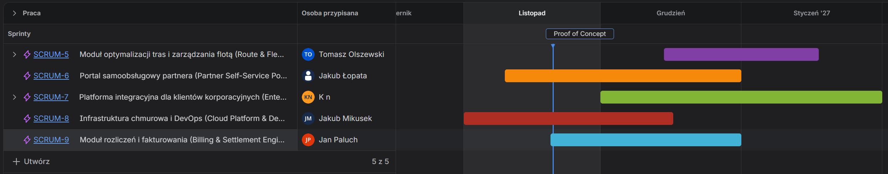
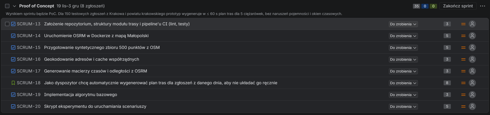

# A. Backlog Produktu i Roadmapa

Link do projektu w Jira: [Jira](https://polzwrottransex.atlassian.net/jira/software/projects/SCRUM/boards/1/backlog)

# B. Planowanie Sprint 1

## 1. Tworzenie Backlogu Produktu

### 1.1 Moduł optymalizacji tras i zarządzania flotą (Route & Fleet Management)

### 1.2 Portal samoobsługowy partnera (Partner Self-Service Portal)

### 1.3 Platforma integracyjna dla klientów korporacyjnych (Enterprise Integration Platform)

### 1.4 Infrastruktura chmurowa i DevOps (Cloud Platform & DevOps)

### 1.5 Moduł rozliczeń i fakturowania (Billing & Settlement Engine)

## 2. Oś czasu

## 1. Cel Sprintu

Wynikiem sprintu będzie PoC. Dla 150 testowych zgłoszeń z Krakowa i powiatu krakowskiego prototyp wygeneruje w ≤ 60 s plan tras dla 5 ciężarówek, bez naruszeń pojemności i okien czasowych.

## 2. Backlog Sprintu

## 3. Definition of Dome

- Kod jest w repozytorium i przeszedł code review przez co najmniej 1 inną osobę. Pull request jest zmergowany do main.
- Pipeline CI przechodzi: lint i testy jednostkowe. Kluczowa logika jest pokryta testami.
- Kryteria akceptacji elementu są spełnione i potwierdzone przez Product Ownera.
- Repozytorium nie zawiera sekretów ani danych osobowych, a skan zależności nie wykazuje podatności krytycznych.
- Dokumentacja jest zaktualizowana.

## 4. Analiza Pre-Mortem

| Ryzyka         | Przyczyna porażki                                                                                                                        | Plan zapobiegawczy                                                                                                       |
| -------------- | ---------------------------------------------------------------------------------------------------------------------------------------- | ------------------------------------------------------------------------------------------------------------------------ |
| Niewykonalność | Niewykonalność Solver nie skaluje się do 500+ punktów. Obliczenia trwają godzinami lub nie znajdują rozwiązania.                         | Test na 500 punktach na poziomie PoC. Limit czasu solvera. Ewentualnie podział na strefy i planowanie nocne.             |
| Niewykonalność | Trasy są nierealne dla ciężarówek. System nie uwzględnia limitów tonażu, Strefy Czystego Transportu ani zakazów wjazdu do Starego Miasta | Profil ciężarówki w systemie. Wykluczone strefy w modelu. Pilotaż z 1 kierowcą przed wdrożeniem.                         |
| Bezpieczeństwo | Masowe fałszywe zgłoszenia zapychają plan i generują puste kursy.                                                                        | Weryfikacja partnera. Limity zgłoszeń na punkt. Rate limiting w API. Anomalie oznaczane do akceptacji przez dyspozytora. |
| Organizacja    | Dyspozytorzy nie ufają systemowi i planują dalej ręcznie.                                                                                | Dyspozytor zatwierdza i może ręcznie korygować plan. Udział dyspozytora w ocenie PoC.                                    |
| Koszty         | Rozwiązanie open-source zawodzi, a komercyjne API przekracza budżet MVP.                                                                 | Wczesna analiza kosztów. Wariant półautomatyczny jako minimalne MVP.                                                     |
